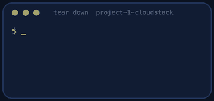

<p align="center"></p>

| | |
|-|-|
| **Time** | 5 days (project) |
| **Cost** | a few cents per hour while it runs (NAT Gateway and 3 servers); destroy it every evening |
| **You need** | An AWS administrator user, the AWS CLI v2, Terraform 1.10 or newer, git, curl and ssh |

## How this lab works

1. **Fork** this repository to your own GitHub account (button at the top right).
2. Clone **your fork** in your Ubuntu environment (WSL on Windows, your OrbStack machine on Mac).
3. Read the lab below (the same text is in [`LAB.md`](LAB.md)) and follow the mission.
4. Answer the questions in [`SUBMISSION.md`](SUBMISSION.md). Where a question asks for output, paste it in a code block. No screenshots needed.
5. Commit and push. Open the **Actions** tab of your fork (click *I understand my workflows, go ahead and enable them* the first time). The **Lab check** shows what is still missing.
6. When the check is green, **submit the URL of your fork** in the course platform.

> [!NOTE]
> The check only looks at your answers and any files the lab asks you to commit. Your instructor reads your work and may ask you to explain any line.

<p align="center"></p>

## What this is

Project 1 is a whole week of building, so there is no step-by-step lab. The **brief** (in the course) tells you what to build: Clippy on AWS in three network tiers, with Terraform. This repository gives you the three things every serious project needs next to the code:

| File | What it does |
|------|--------------|
| `verify.sh` | Reads your repository **and your real AWS account** and prints PASS or FAIL for about 35 requirements: subnets and routes, security groups that reference each other, no public IP on the private tiers, IMDSv2, remote state with locking and versioning, no secrets in git, and then the live checks against your public URL |
| `SUBMISSION.md` | The questions you answer when you hand in the project, with pasted output and no screenshots |
| `teardown.sh` and `verify-teardown.sh` | Destroy it and **prove** nothing is left running (a NAT Gateway bills every hour) |

> [!IMPORTANT]
> **Your mission**
> - Fork this repository: it is also where your project lives (`terraform/`, `deploy.sh`, `nginx/`, `systemd/`, `docs/`, `README.md`)
> - Build the three tiers (read the brief first)
> - Run `./verify.sh` often. It is the same list your instructor uses. Fix what is red.
> - On the last day answer `SUBMISSION.md`, destroy everything and paste `./verify-teardown.sh`

**Time:** 5 days (project) | **Cost:** a few cents per hour while it runs (NAT Gateway and 3 servers); destroy it every evening | **You need:** an AWS administrator user, the AWS CLI v2, Terraform 1.10 or newer, git, curl and ssh.

<p align="center"></p>

## Rules the checker relies on

1. In the AWS provider block use `default_tags { tags = { Project = "cloudstack" } }`. Every resource carries the tag, and the checker (and the teardown proof) find your resources by it.
2. Name the instances `proxy-server`, `app-server` and `data-server` (tag `Name`), and the key pair `cloudstack`.
3. Put all Terraform in `terraform/`. Keep the private key (`*.pem`), the state and your secrets out of git (`.gitignore`). Passwords for PostgreSQL and Redis are generated on your machine and never committed.
4. Deploy Clippy at the tag `v0.2.0`: `https://github.com/professordiogodev/clippy`.

## Using the checker

```bash
./verify.sh
```

It needs working AWS credentials (`aws sts get-caller-identity`), Python 3 and curl. Before anything is built it fails on the first AWS check; that is normal. As you build, the list turns green from the top.

> [!NOTE]
> **Think** `verify.sh` checks that the app server has *no public IP*, and then that the app's private IP times out from your laptop. Why are both needed? What could make the first true and the second false?

## Your IP changes

Your SSH rule allows **one address** (your public IP as `/32`). If your network changes (home, café, mobile) SSH silently times out. The fix is a variable you update, not `0.0.0.0/0`.

> [!NOTE]
> **Think** What would an attacker do with port 22 open to the world on a server with a password-less sudo user and an old key? Which control in front of the private tiers makes this a smaller problem than it looks?

## Tearing down

```bash
./teardown.sh
./verify-teardown.sh
```

Empty and delete your state bucket (all versions) after the destroy has finished, delete `cloudstack.pem` and `.secrets/`, and paste the output of `./verify-teardown.sh` in `SUBMISSION.md`. It must end with **TEARDOWN VERIFIED**.

<!-- teardown:start (generated by labs.py, do not edit) -->
## Tear down (mandatory)

<p align="center"></p>

Resources left behind cost money, keep doors open and pollute the next lab. Removing what you created is part of the job, so it is part of the submission: **you must prove it is gone**.

Do this **last**, after you have pasted your `verify` output into `SUBMISSION.md` (once you tear down, the lab can no longer be verified).

1. In `terraform/` run `terraform destroy`. Delete the state bucket only after the destroy has finished (empty it, including all versions, then remove it). Delete `cloudstack.pem` and the `.secrets/` folder.

Then run the proof:

```bash
./verify-teardown.sh
```

It prints a list of checks and must end with **TEARDOWN VERIFIED**. If it reports leftovers, remove them and run it again. Paste the full output in your submission.
<!-- teardown:end -->

<!-- submission:start (generated by labs.py, do not edit) -->
## 📬 Submission

Answer the questions in `SUBMISSION.md` in **your fork** (paste output in code blocks where asked), push, then submit the **URL of your fork**.

**Files to commit**

- `terraform/` with all your `.tf` files, `deploy.sh`, `nginx/`, `systemd/clippy.service`, `README.md` and `docs/architecture.png` (or a diagram in the README)

**Questions to answer**

1. Paste the output of `terraform output` and the URL of your public site. Paste `curl -s -X POST <url>/shorten ...` and its answer.
2. Show the rules of your three security groups (`terraform state show` or `aws ec2 describe-security-group-rules`). For `sg-app` and `sg-data`, why is the source a security group and not a CIDR block?
3. Prove the private tiers are unreachable from the internet: paste `aws ec2 describe-instances` showing no public IP on the app and data servers, and a `curl --max-time 5` to the app private IP that times out. Why can the proxy reach them but you cannot?
4. Run `./deploy.sh` twice and paste the end of both runs. What did you do to make the second run safe? Where do the database and Redis passwords live, and why are they not in git?
5. Where is your Terraform state and how is it protected (bucket versioning, locking)? What happens if two people run `terraform apply` at once?
6. Explain one thing that went wrong during the project: what you saw first, how you found the cause, and what you changed.
7. Paste the output of `./verify.sh`. It must end with **ALL CHECKS PASSED**.
8. **Tear down.** Paste the output of `./verify-teardown.sh`. It must end with **TEARDOWN VERIFIED**.
<!-- submission:end -->
